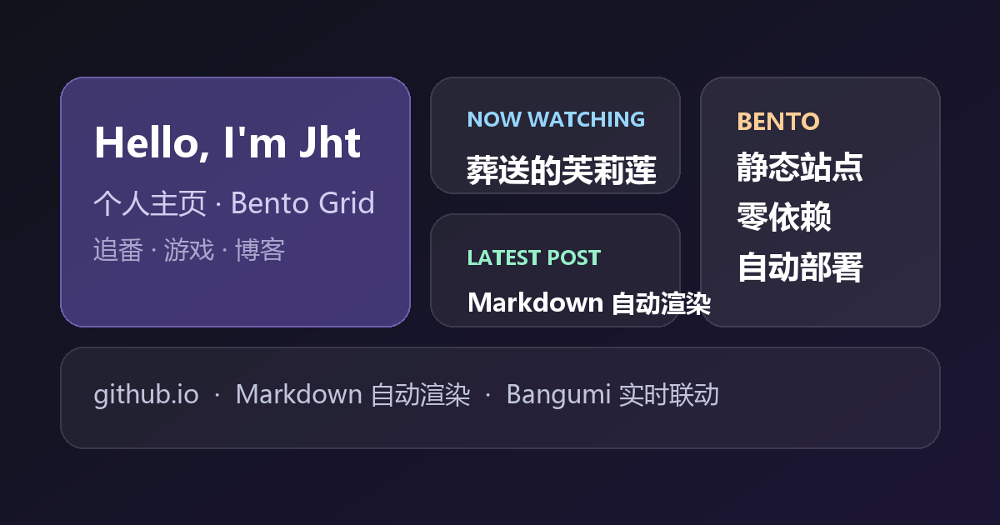

# Bento 个人主页

一个可以直接放到 GitHub Pages 上的静态个人主页：**Bento Grid 布局**、**Bangumi 追番/游戏联动**、**Markdown 自动构建成文章**，零第三方依赖、零 `npm install`。



## 功能一览

| 功能 | 说明 |
| --- | --- |
| Bento Grid 首页 | 12 列网格，卡片大小即信息层级，深 / 浅色双主题 |
| Bangumi 联动 | 实时拉取「在看」的番剧与「在玩」的游戏，含封面、评分、进度条；接口失败自动回退本地快照 |
| Markdown 博客 | 在 `posts/` 放一个 `.md`，推送后由 Actions 自动渲染成文章页 |
| 文章列表页 | 标签筛选、关键词搜索、分页、阅读时长 |
| 文章阅读页 | 代码高亮 + 一键复制、自动目录、阅读进度条、上一篇/下一篇 |
| 自动部署 | 推送到 `main` 即发布；也能手动触发，每天定时刷新 Bangumi 快照 |
| 附加 | RSS（Atom）、sitemap、robots、404 页面、SEO / Open Graph 标签 |

## 快速开始（3 步上线）

### 1. 创建仓库

GitHub Pages 有两种地址，本模板都支持：

| 仓库名 | 访问地址 |
| --- | --- |
| `<你的用户名>.github.io` | `https://<你的用户名>.github.io/` |
| 任意名字，如 `bento-home` | `https://<你的用户名>.github.io/bento-home/` |

### 2. 推送代码

```bash
cd bento-home
git init
git add .
git commit -m "init: bento homepage"
git branch -M main
git remote add origin https://github.com/<你的用户名>/<仓库名>.git
git push -u origin main
```

### 3. 打开 Pages

仓库 → **Settings → Pages → Build and deployment → Source** 选择 **GitHub Actions**。

之后每次 `git push` 都会自动构建并发布。也可以在 **Actions → Deploy to GitHub Pages → Run workflow** 手动触发。

## 改成你自己的

### 基本信息

编辑 [`assets/js/config.js`](assets/js/config.js)，所有文字都在这里：

```js
window.SITE_CONFIG = {
  name: "你的名字",
  siteTitle: "你的小站",
  headline: "一句话介绍自己",
  bio: "一段更长的自我介绍",
  avatar: "assets/img/avatar.png",     // 换成你自己的头像文件
  url: "https://你的用户名.github.io/", // 部署后的地址
  tags: ["前端", "番剧", "游戏"],
  socials: [
    { label: "GitHub", href: "https://github.com/你的用户名", icon: "github" },
    // ...
  ],
};
```

### 接入 Bangumi

1. 找到你的 Bangumi 主页：`https://bgm.tv/user/你的ID`
2. 把 ID 填进配置：

```js
bangumi: {
  username: "你的ID",
  nickname: "你的昵称",
  live: true,   // true = 浏览器实时请求（数据最新）
  animeLimit: 3,
  gameLimit: 3,
}
```

首页会立刻显示你标记为「在看」的番剧和「在玩」的游戏。想离线可用或降低接口压力，可以：

```bash
npm run bangumi     # 生成 assets/data/bangumi.json 快照
```

> 番剧和游戏都取自 Bangumi 的**公开收藏**（`type=3`，即在看 / 在玩），不需要 token。
> 如果某个收藏是私密的，接口不会返回它。

### 写文章

**方式一：命令行**

```bash
npm run new "文章标题" -- --tags 番剧,杂谈
```

**方式二：手动新建**

在 `posts/` 下新建 `任意名字.md`：

```markdown
---
title: 文章标题
date: 2026-10-18 21:30
tags: [教程, Markdown]
summary: 显示在列表页的一句话摘要（可省略，自动截取正文）
cover: assets/img/cover.jpg      # 可选，文章头图
pinned: false                    # 可选，置顶
draft: false                     # 可选，true 时线上不构建
---

正文从这里开始，正常写 Markdown 即可。
```

保存后 `git push`，会自动渲染成 `posts/任意名字.html` 并出现在首页与文章列表。

**front-matter 字段说明**

| 字段 | 必填 | 说明 |
| --- | --- | --- |
| `title` | 否 | 不填则用文件名 |
| `date` | 推荐 | 支持 `2026-10-18` 或 `2026-10-18 21:30`；不填用文件修改时间 |
| `tags` | 否 | `[a, b]` 或 `a, b` |
| `summary` | 否 | 不填自动截取正文前 110 字 |
| `cover` | 否 | 文章头图，路径相对于仓库根目录 |
| `pinned` | 否 | 置顶到列表最前 |
| `draft` | 否 | 草稿，线上跳过；本地可 `--drafts` 预览 |

文章里的图片：

- 放 `assets/img/`，正文写 ``（构建时自动处理相对路径）
- 或直接引用外链图片

## 本地预览

需要 Node.js 20+（不需要 `npm install`，依赖已内置在 `scripts/vendor/`）。
**如果电脑上没有装 Node 也没关系**：Markdown 构建是在 GitHub Actions 上跑的，你只需要写 `.md` 然后推送即可，本地命令只是用来预览。

```bash
npm run dev          # 构建 + 本地服务器 http://localhost:4173
npm run build        # 只构建，产物在 dist/
npm run build -- --drafts        # 连草稿一起构建
npm run build -- --base-url https://name.github.io/repo/   # 指定线上地址
```

Windows 上如果 `node` 不在 PATH，可以用完整路径执行：

```powershell
& "C:\Program Files\nodejs\node.exe" scripts\dev.mjs
```

## 目录结构

```
bento-home/
├─ index.html               首页（Bento Grid）
├─ 404.html                 构建时生成
├─ posts/                   ← 你只在这里写 Markdown
│  ├─ hello-markdown.md     示例文章
│  └─ *.md
├─ assets/
│  ├─ css/  base.css · home.css · article.css
│  ├─ js/   config.js · site.js · bangumi.js · posts.js · article.js · archive.js
│  ├─ img/  avatar.png · og-cover.png · demo/（示例封面）
│  └─ data/bangumi.json     Bangumi 快照（同步后生成）
├─ scripts/
│  ├─ build.mjs             Markdown → 站点（核心）
│  ├─ dev.mjs               本地预览服务器
│  ├─ new-post.mjs          新建文章
│  ├─ sync-bangumi.mjs      抓取 Bangumi 快照
│  └─ vendor/               marked + highlight.js（内置，无需安装）
└─ .github/workflows/deploy.yml
```

## 工作原理

```
posts/*.md ──build.mjs──► dist/
                          ├─ index.html（静态拷贝）
                          ├─ posts/<slug>.html  文章页
                          ├─ posts/index.html   列表页
                          ├─ posts/index.json   首页「最近文章」数据
                          ├─ feed.xml / sitemap.xml / robots.txt
                          └─ 404.html
```

- 构建只依赖 Node 内置模块 + `scripts/vendor/` 里的两个库，速度约 0.3 秒
- 部署时 `actions/configure-pages` 会提供真实的 `base_url`，所以放在子路径仓库也能正确生成链接
- Bangumi 抓取失败不会中断部署，会保留仓库中上一次的快照

## 常见问题

**Q：首页一直显示「示例数据」？**
A：说明 `bangumi.username` 还是占位值，或浏览器请求被拦截。改好用户名后刷新；也可以运行 `npm run bangumi` 生成快照兜底。

**Q：文章不显示？**
A：检查 front-matter 的两条 `---` 是否闭合、`draft` 是否为 `true`，以及文件名是否以 `.md` 结尾。

**Q：部署后样式丢失？**
A：Pages 的 Source 需要选 **GitHub Actions**（不是 Deploy from a branch）；本仓库产物在 `dist/`，需要经过 Actions 上传。

**Q：文章文件名可以用中文吗？**
A：可以，构建时会自动做 URL 编码。不过更推荐用英文短横线命名（如 `hello-world.md`），分享出去的链接更短、更兼容。

**Q：想换配色？**
A：改 [`assets/css/base.css`](assets/css/base.css) 顶部的 `:root` 变量（`--accent`、`--grad` 等），深浅色主题会自动跟随。

## 第三方库

- [marked](https://github.com/markedjs/marked) — MIT
- [highlight.js](https://github.com/highlightjs/highlight.js) — BSD-3-Clause

两者都以单文件形式内置于 `scripts/vendor/`，构建时不需要联网安装。

## License

MIT
